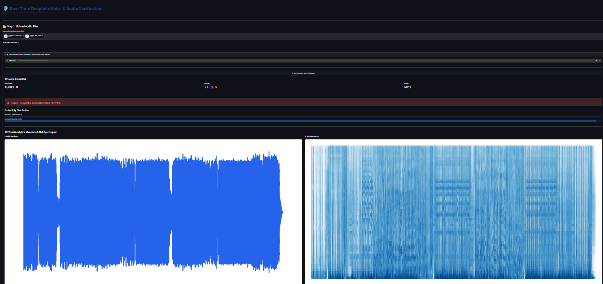

# 🛡️ Real-Time Deepfake Voice & Audio Verification System

An enterprise-grade, high-fidelity deepfake voice detection system designed for banking security and biometric authentication. This project features a professional Streamlit dashboard integrating advanced deep learning models to distinguish between genuine customer voices and AI-generated synthetic speech.

---

## 📸 Dashboard Preview


---

## 🚀 Key Features
- **Multi-Modal Architecture:** Combines Wav2Vec 2.0 feature embeddings with a 3-Layer Convolutional Neural Network (CNN).
- **Interactive Streamlit Dashboard:** Clean, banking-grade UI supporting multi-file batch uploads and session persistence.
- **Advanced Acoustic Analytics:** Instant generation and visualization of raw Audio Waveforms and Mel-Frequency Spectrograms.
- **Risk Assessment & Confidence Scoring:** Real-time probability breakdown and security threat classification.

---

## 🛠️ Tech Stack
- **Deep Learning:** PyTorch, Torchaudio
- **Audio Processing:** Librosa, NumPy
- **Visualization:** Matplotlib, Seaborn
- **Frontend Dashboard:** Streamlit

---

## 📂 Project Structure
```text
deepfake_audio_verification/
│
├── models/
│   └── banking_deepfake_detector.pth   # Trained neural network weights
│
├── src/
│   ├── model.py                        # Network architecture (Wav2Vec + 3-Layer CNN)
│   └── predict.py                      # Core inference and feature extraction logic
│
├── assets/
│   └── dashboard_preview.png           # UI screenshot for documentation
│
├── app.py                              # Main Streamlit dashboard application
├── requirements.txt                    # Project dependencies
└── README.md                           # Project documentation